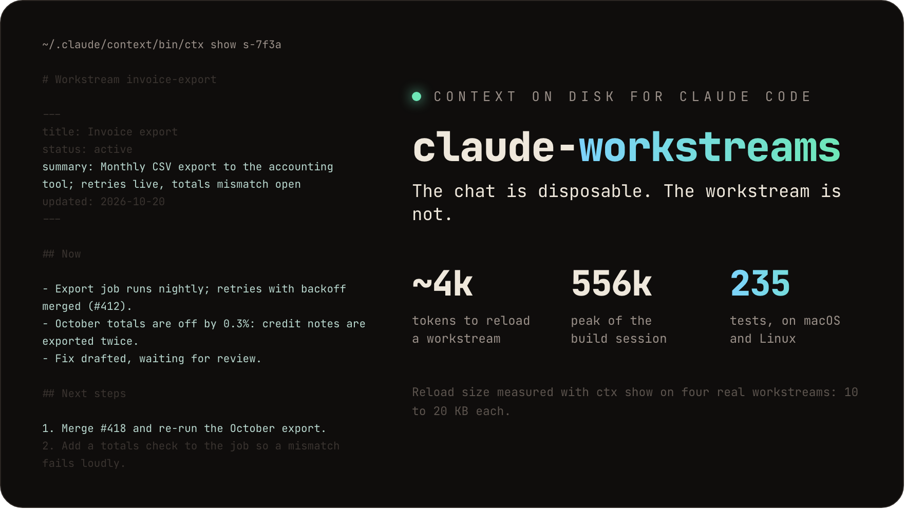
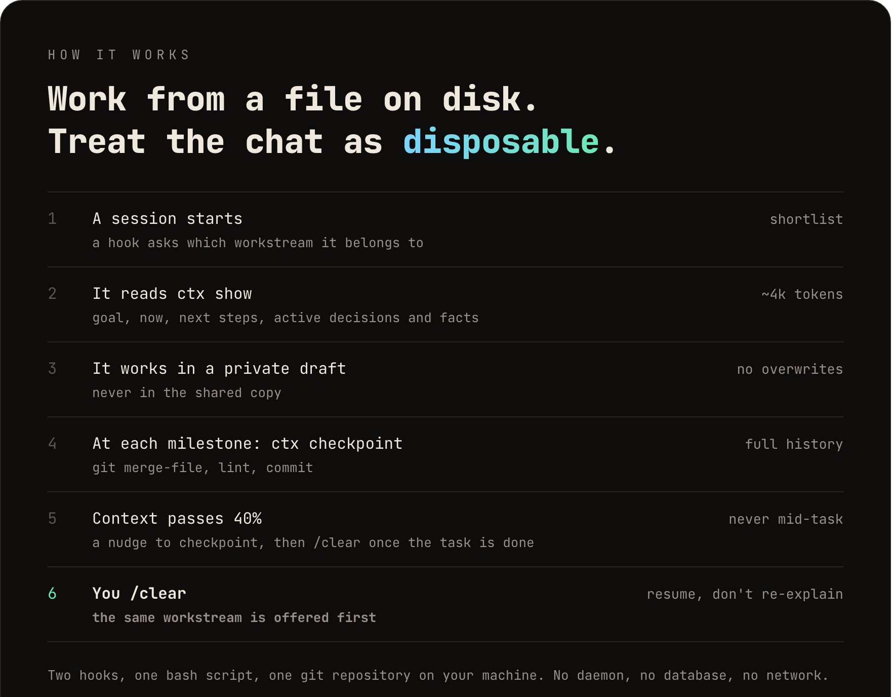
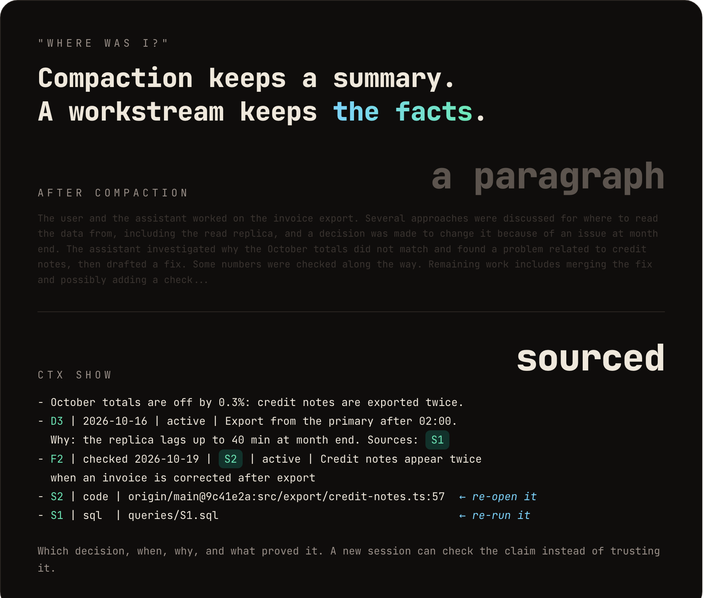
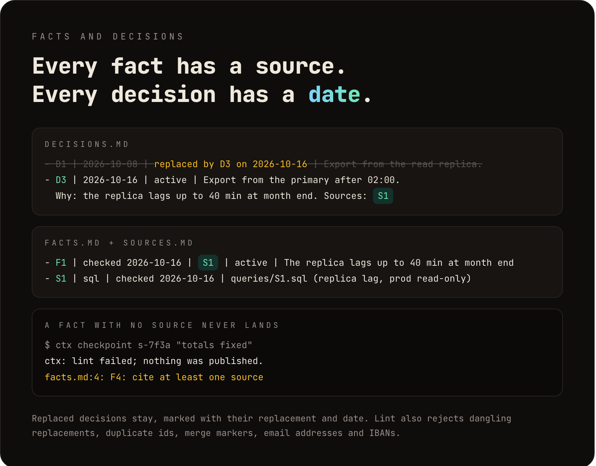
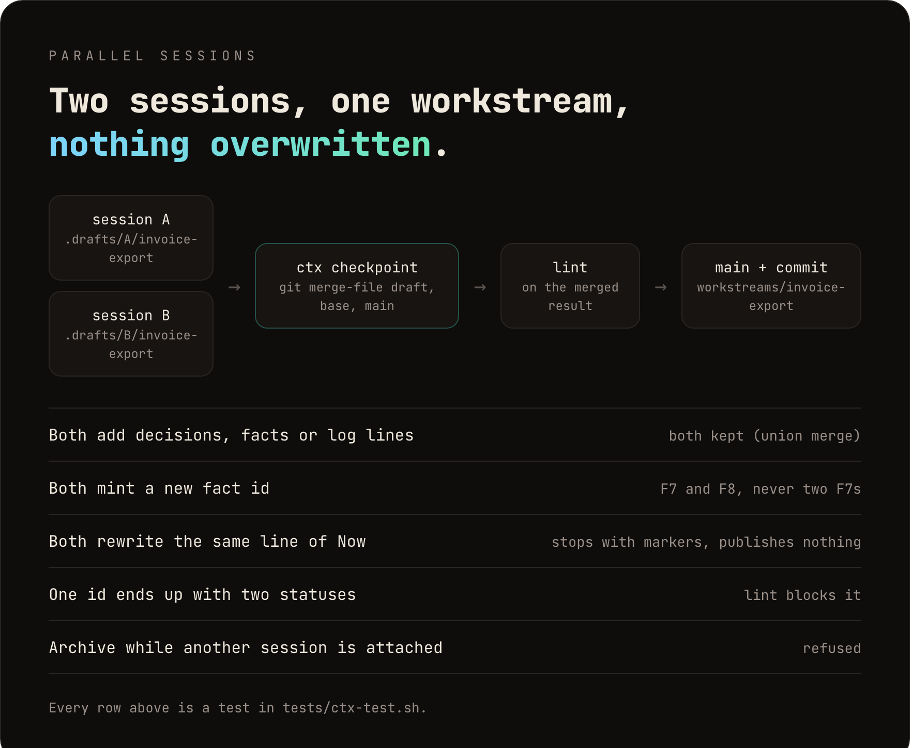
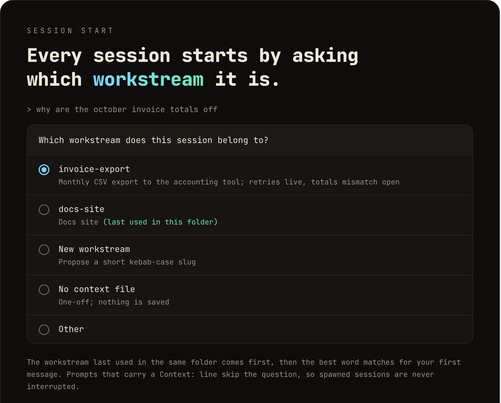

<h1 align="center">claude-workstreams</h1>

<p align="center">
  <em>The chat is disposable. The workstream is not.</em>
</p>

<p align="center">
  
  
  
  
</p>

<p align="center">
  
</p>

<p align="center">
  <strong>Durable, git-backed context for Claude Code.</strong><br>
  Checkpoint, <code>/clear</code>, and pick up where you left off from a few thousand tokens,<br>
  instead of dragging a half-million-token chat through compaction.<br>
  <sub>Reload size measured with <code>ctx show</code> on four real workstreams (10 to 20 KB each). The 556k is the session that built this tool.</sub>
</p>

```bash
curl -fsSL https://raw.githubusercontent.com/mfaour34/claude-workstreams/main/install.sh | bash
```

<p align="center">
  <sub><a href="#how-it-works">How it works</a> &middot; <a href="#install">Install</a> &middot; <a href="#workstream-pane-optional">Pane</a> &middot; <a href="#commands">Commands</a> &middot; <a href="#faq">FAQ</a> &middot; <a href="docs/design.md">Design</a></sub>
</p>

---

## How it works

<p align="center">
  
</p>

Every session works from a **workstream**: a small folder of Markdown files with the goal, the current state, dated decisions, sourced facts, traps and a log. Two hooks and one bash script keep it current; a local git repository keeps its history.

The chat stops being the place where the work lives. When it gets long, you clear it and lose nothing that mattered.

## Where was I?

<p align="center">
  
</p>

Compaction decides what to keep, and keeps it as prose. A workstream keeps the decision, its date, its reason, and the evidence behind every fact, so the next session can check a claim instead of trusting it.

## Every fact has a source

<p align="center">
  
</p>

Decisions are dated and never deleted: a changed decision gets a new id and the old one is marked `replaced by D3 on 2026-10-16`. Facts cite sources with a kind, a checked date and an exact locator. `ctx lint` enforces all of it on every checkpoint, and also rejects email addresses and IBANs.

## Parallel sessions

<p align="center">
  
</p>

No session ever writes the shared copy. Each edits its own draft, and `ctx checkpoint` merges through git. Append-only files merge with `--union`, so two sessions adding facts never conflict; two sessions rewriting the same line of "Now" stop with markers instead of silently keeping one.

## The shortlist

<p align="center">
  
</p>

A new session asks once, before any work. After a `/clear` the workstream you were on comes back first. Spawned sessions skip the question when their brief carries a `Context:` line.

## Install

One line:

```bash
curl -fsSL https://raw.githubusercontent.com/mfaour34/claude-workstreams/main/install.sh | bash
```

Or from a clone, to read the code first or contribute:

```bash
git clone https://github.com/mfaour34/claude-workstreams.git
cd claude-workstreams
./install.sh
```

Then start a new Claude Code session: it asks which workstream it belongs to.

To keep the context folder somewhere other than `~/.claude/context`, prefix either command with `CTX_HOME=/path/to/folder`. The installed script finds its own folder afterwards.

What the installer does:

- copies `ctx` to `<context folder>/bin/ctx` and creates the context repository there;
- adds a `SessionStart` and a `UserPromptSubmit` hook to `~/.claude/settings.json`, and wraps your existing status line (it still renders as before);
- appends a marked rules block to `~/.claude/CLAUDE.md` and installs the `context` skill;
- records where it was installed from (the one-line install keeps a clone in `<context folder>/.src`);
- backs up a file only when it actually changes it (`*.bak-claude-workstreams-<timestamp>`), then runs `ctx doctor`.

Re-running it is safe: nothing is duplicated.

**Requirements:** Claude Code (terminal or desktop app), macOS or Linux, `bash` 3.2+, `jq`, `git` 2.28+, `awk`.

## Update

```bash
~/.claude/context/bin/ctx update
```

Fast-forwards the source it was installed from, re-runs the installer with the same folder, and runs `ctx doctor`. Open sessions pick up the new version on their next message; the script is swapped atomically, so a hook running at that moment finishes on the old one. If the source has local changes, `update` stops and changes nothing.

## Backup and a second machine (optional)

Off by default: without it, nothing leaves your machine. The local copy is always the one that counts. To back it up, create an empty **private** repository and install with `--remote`:

```bash
curl -fsSL https://raw.githubusercontent.com/mfaour34/claude-workstreams/main/install.sh | bash -s -- --remote git@github.com:<you>/<private-repo>.git
```

or `./install.sh --remote <url>` from a clone. This sets `origin` on the context folder and turns on the daily push: the first session start of each day pushes in the background, and only when there are commits the remote does not have yet. It never pulls. `ctx push` pushes now.

Already installed? Run the same command again: on an existing folder `--remote` only sets `origin` and turns the daily push on, and your workstreams and history stay as they are. If the remote already holds workstreams from another machine, the two histories are unrelated and `ctx pull` refuses to merge them; point `--remote` at an empty repository instead, or start from one machine's folder.

On another machine, run the same command before anything else. On a fresh folder `--remote` takes the workstreams from the remote, then installs as usual. Run `ctx pull` when you switch machines: it merges the remote into the local copy, keeps additions from both sides, and stops without changing anything if both machines rewrote the same line in a `now.md`. When a daily push is rejected because the other machine pushed first, the next session start says so; `ctx pull` fixes it.

To turn the daily push off again: `git -C <context folder> config ctx.dailypush false`.

## Workstream pane (optional)

A Claude Code plugin that opens a **Workstream** pane beside the conversation, in the Claude desktop app and the fullscreen terminal. Under a header with the session's workstream (or "No workstream yet"), it has four sections:

- **Status:** the draft (clean, or which files have unpublished edits), the last checkpoint and how long ago it was, context used and the threshold of the next nudge;
- **Checkpoint:** a message field and a button;
- **Now:** the goal, current state and next steps, with active decisions, facts and the log behind a toggle;
- **Other workstreams:** the rest of the index.

Type a message and press **Checkpoint** to run `ctx checkpoint` for this session; the pane shows what `ctx` answered, merge conflicts and lint errors included. Nothing else in the pane writes. It refreshes when a turn ends, after a checkpoint, on **Refresh**, and every 10 seconds. `/workstream` reopens it after you close it.

Closed the pane? A band above the prompt shows the workstream and the draft state, with an **Open workstream** button; `/workstream` works too.

Install it with the rest:

```bash
curl -fsSL https://raw.githubusercontent.com/mfaour34/claude-workstreams/main/install.sh | bash -s -- --with-pane
```

or `./install.sh --with-pane` from a clone. This adds the source as a local plugin marketplace and installs `workstream-pane@claude-workstreams` from it, so `ctx update` updates the pane too. It needs the `claude` CLI on `PATH` and a Claude Code build that loads plugin hooks modules (tested on 2.1.299). Already have `ctx` installed? Add only the pane from a terminal session:

```
/plugin install workstream-pane --marketplace mfaour34/claude-workstreams
```

The pane reads everything through `ctx status <session>` and finds `ctx` from the `SessionStart` hook in `~/.claude/settings.json`, so it needs no configuration.

## Daily use

1. **Start a session.** Answer the workstream question. The agent reads `ctx show <session>` and works from it.
2. **Work.** The agent checkpoints at milestones: a decision made, a finding verified, a PR opened, a plan changed. Say `checkpoint` to trigger one yourself.
3. **Clear when it is large.** When the nudge appears, finish the task, then `/clear`. The next session offers the same workstream first.
4. **Finish.** Mark it done and run `ctx archive <slug> <session>`.

To brief a spawned session, put this line in its prompt:

```
Context: ~/.claude/context/workstreams/<slug>
```

## Commands

| Command | What it does |
|---------|--------------|
| `ctx list` | Index of active and paused workstreams |
| `ctx show <session>` | Read view: now.md, active decisions and facts, sources, traps, artifacts, last five log lines |
| `ctx new <slug> "<title>" <session>` | Create a workstream and the session's draft |
| `ctx register <session> <slug\|none>` | Attach a session (`none`: no context file) |
| `ctx current <session>` | The session's workstream |
| `ctx next-id <session> <D\|F\|S>` | Next free decision, fact or source id |
| `ctx lint <dir>` | Formats, citations, replacements, duplicate ids, conflict markers, personal data, size |
| `ctx checkpoint <session> "<message>" [slug]` | Merge the draft into the main copy and commit |
| `ctx archive <slug> <session> [--force]` | Move a finished workstream to `archive/`; refuses while other sessions are attached |
| `ctx drop <session>` | Delete a session's drafts |
| `ctx candidates "<text>" [cwd]` | Best-matching workstreams for a text |
| `ctx status <session> [transcript]` | Everything the pane shows, as JSON: workstream, read view, draft edits, last checkpoint, context use, next nudge, index. Read-only |
| `ctx doctor` | Check the installation |
| `ctx update` | Pull the latest release and reinstall |
| `ctx push` | Push unpushed commits to `origin` now (with `--remote`, session start does it once a day) |
| `ctx pull` | Merge `origin` into the local copy; stops without changes on a conflict |

All commands live at `~/.claude/context/bin/ctx`. The session id appears in the hook messages; `tail -3 ~/.claude/context/.sessions.tsv` shows the latest ones.

<details>
<summary><strong>Workstream format</strong></summary>

```
workstreams/<slug>/
  now.md          frontmatter, Goal, Now, Next steps (rewritten)
  decisions.md    - D3 | 2026-10-19 | active | Use a mkdir lock. Why: macOS has no flock. Sources: S4
  facts.md        - F4 | checked 2026-10-19 | S1, S2 | active | The vendor API answers 404 for unsplit orders
  sources.md      - S1 | sql | checked 2026-10-19 | queries/S1.sql (prod db, read-only)
  traps.md        - <what bit us>
  artifacts.md    - <links to PRs, specs, docs>
  log.md          - 2026-10-19 <session>: <one to three lines>
  history.md      replaced decisions and facts, moved here when trimming
  queries/S1.sql  long queries cited as sources (never results)
```

A workstream stays under 30 KB, `history.md` excluded.

</details>

<details>
<summary><strong>The context nudge</strong></summary>

The prompt hook needs the session's context size:

- **Terminal CLI:** the status line wrapper records `context_window.used_percentage`.
- **Desktop app:** the status line never runs there, so the hook reads the last main-thread token usage from the transcript against a 1,000,000-token window. Set `CTX_CONTEXT_WINDOW_TOKENS` (for example `200000`) in the environment Claude Code runs in to change that.

At 40%, and every 10% after, the agent is told to checkpoint at the next milestone and to suggest `/clear` only once the task is finished.

</details>

## FAQ

**Does it send my notes anywhere?**
No. Everything lives in a local git repository with no remote, unless you install with `--remote` (see Backup). Lint rejects email addresses and IBANs, and the rules tell the agent never to store secrets or query results.

**Do I really get asked every session?**
Once, at the start, and the right answer is usually the first option. Pick "No context file" for one-off questions. Spawned sessions with a `Context:` line and subagents are never asked.

**What if two sessions change the same thing?**
Additions from both are kept. Rewrites of the same line stop with conflict markers in the second session's draft, and nothing is published until it resolves them.

**A hook broke. Will it block my session?**
No. Hooks fail open: an error makes a session quiet, never stuck. `ctx doctor` tells you what is wrong.

**Does it work in the Claude desktop app?**
Yes, and in the terminal. Cloud sessions do not read `~/.claude/settings.json`, so they get no hooks.

**Why bash?**
Every hook has to answer in under a second on any Mac or Linux box, with nothing to install but `jq` and `git`.

## Uninstall

```bash
./uninstall.sh
```

Removes the hooks, restores your original status line, removes the rules block, the skill and the pane plugin, and leaves your workstreams (and the `.src` clone of a one-line install) in the context folder.

## Tests

```bash
tests/ctx-test.sh
tests/install-test.sh
claude plugin test pane
```

CI runs them on Ubuntu and macOS, and validates the plugin and its marketplace with `claude plugin validate`. The images in this README are rendered from `assets/src` with `assets/src/render.sh`, from real `ctx` output.

## Design

[docs/design.md](docs/design.md) covers the decisions behind the layout, the merge strategy and the nudge, and the prior art they borrow from.

## License

MIT
